🍽️ Dine — Food Ordering Application

Dine is a food ordering application designed as an academic project. The project focuses on creating a simple, modern, and user-friendly experience for discovering restaurants, selecting food, placing orders, and completing checkout.

🎯 Project Overview

The Dine application was first designed using Figma and is being developed using Flutter.

The project includes both Low-Fidelity (Lo-Fi) and High-Fidelity (Hi-Fi) designs before moving toward application development.

✨ Main Features

- Welcome screen
- User welcome-back screen
- Home page
- Food and restaurant search
- Restaurant categories
- Popular restaurants
- Restaurant menu
- Food item selection
- Shopping cart
- Checkout
- Payment method selection
- Order confirmation

🎨 UI/UX Design

The interface was designed in Figma using a mobile-first approach.

Design Process

Idea → Lo-Fi Wireframe → Hi-Fi Prototype → Flutter Development

Figma Prototype: [[View Dine Figma Prototype](https://www.figma.com/design/PDrGh6RWxP3MxdfDgqejLH/Dine-Food-Ordering-App?node-id=0-1&m=dev&t=yGk9FkpmVQ9MEG0C-1)]

🛠️ Technologies Used

- Figma — UI/UX design and prototyping
- Flutter — Application development
- Dart — Programming language
- GitHub — Version control and project management

📱 Screens

Screenshots of the Dine application will be added here as development progresses.

👨‍💻 Project Purpose

This project was developed as part of an academic Software Engineering project to gain practical experience in UI/UX design, application development, and software project management.

🚀 Future Improvements

- User authentication
- Restaurant database
- Real-time order tracking
- Online payment integration
- Restaurant owner dashboard
- Order history
- Backend and database integration

📌 Project Status

Currently in development.

---

Developed as an academic project

Dine — Food Ordering Application
## Hi-Fi Designs

These high-fidelity designs show the final visual appearance of the Dine food ordering application.

### 1. Welcome
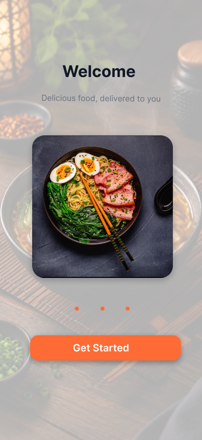

### 2. Welcome Back
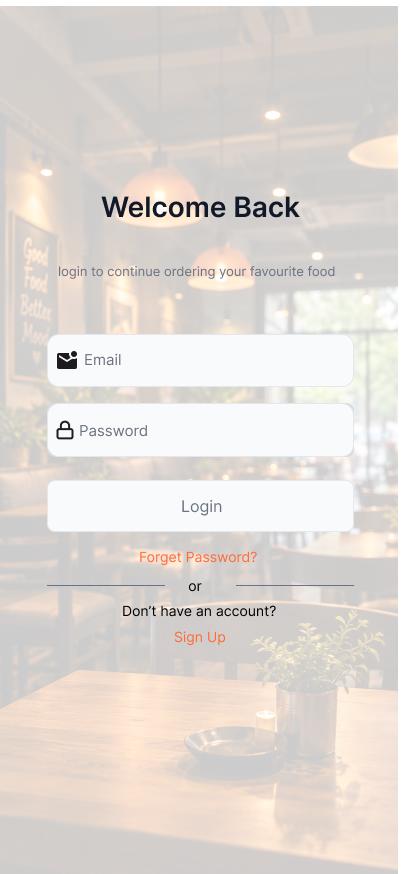

### 3. Home
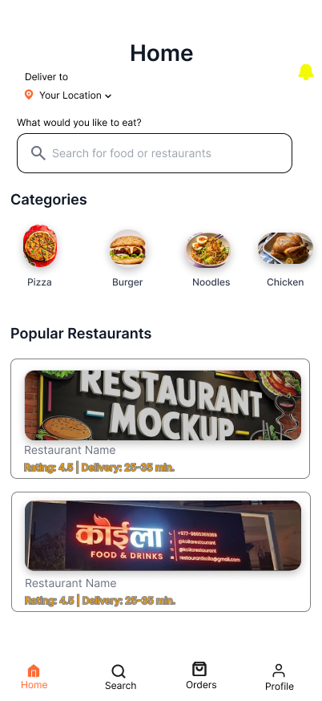

### 4. Restaurant Menu
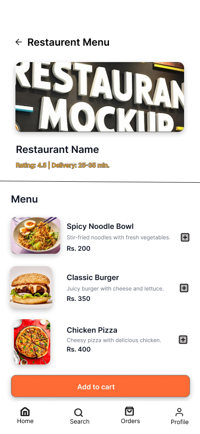

### 5. Cart
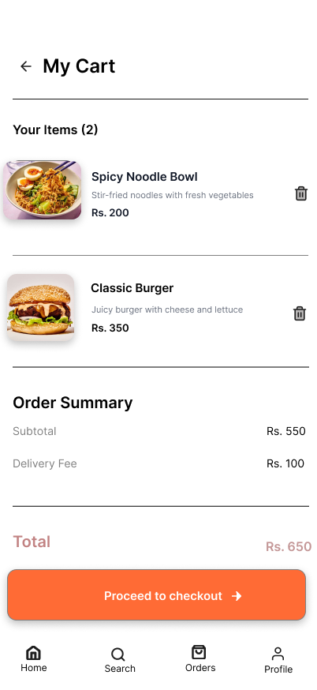

### 6. Checkout
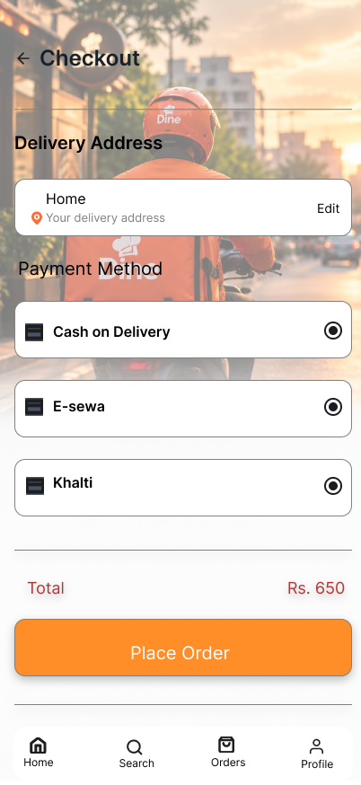

### 7. Order Confirmation
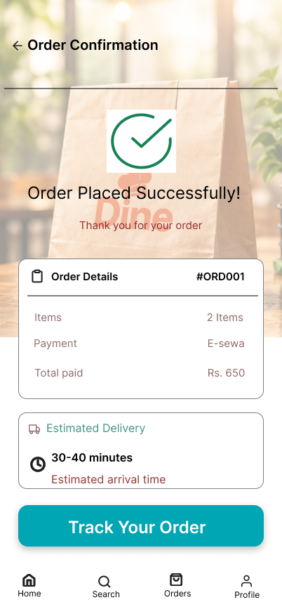
## 📝 Lo-Fi Wireframes

These low-fidelity wireframes show the initial structure and layout of the Dine food ordering application before the high-fidelity design stage.

### Welcome
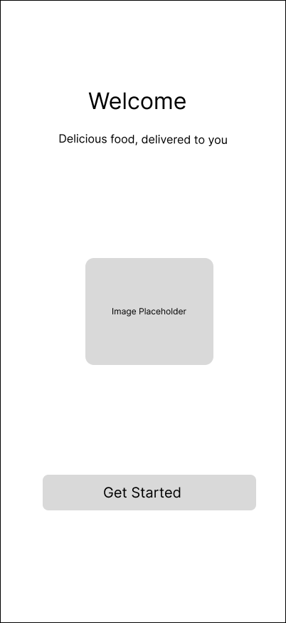

### Home
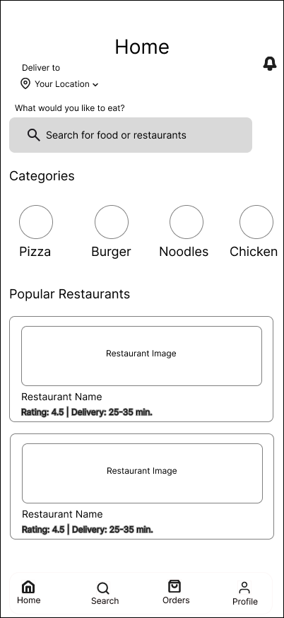

### Restaurant Menu
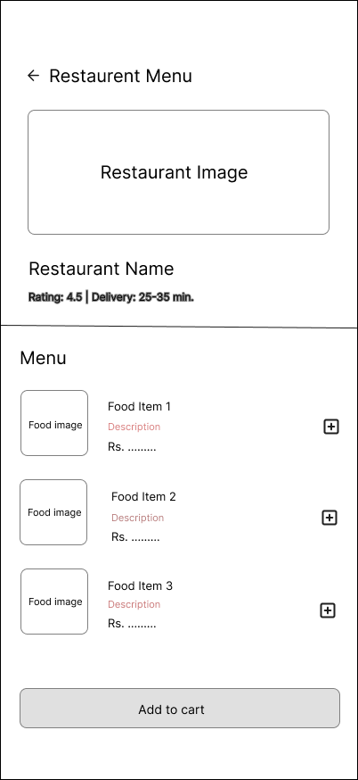

### Cart

### Checkout

### Order Confirmation
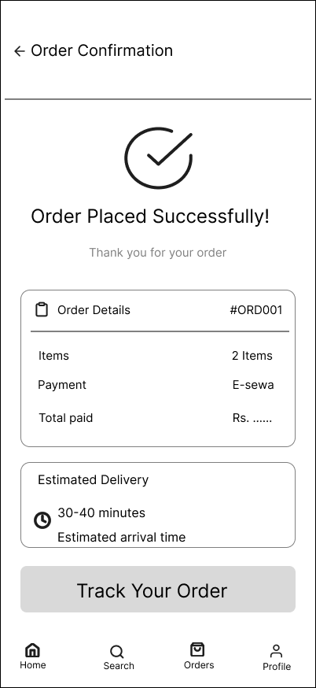

Project Status

The UI/UX design phase of Dine is complete, including low-fidelity wireframes and high-fidelity screens. The interactive Figma prototype is available through the link above.

Flutter app development is ongoing.
